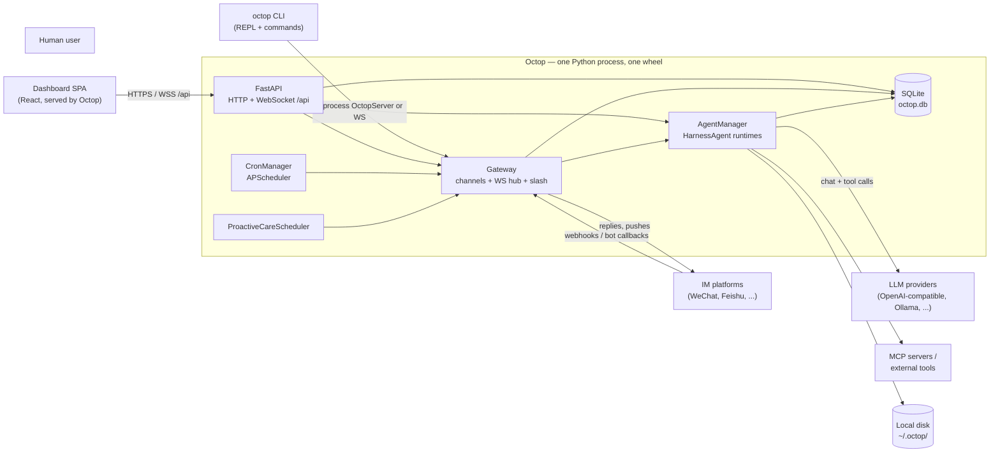
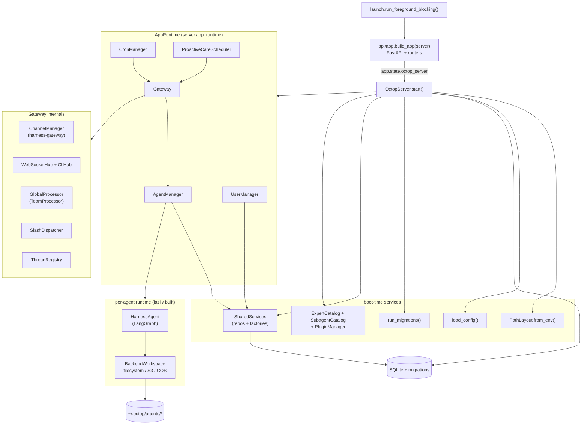
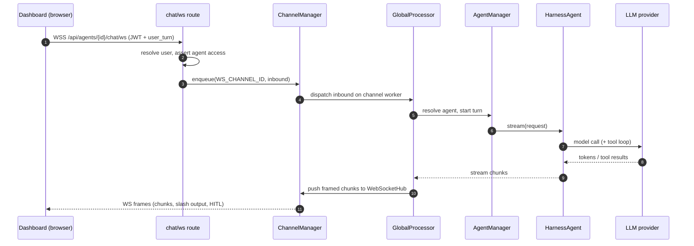

# Architecture

Octop is a self-hosted AI assistant platform for multiple users and agents,
delivered as a single Python process.
It glues three reusable libraries — `harness-agent` (LangGraph-based
chat runtime), `harness-gateway` (IM channel pipeline), and a React
+ TypeScript dashboard — into one wheel that ships with a CLI, an
HTTP/WebSocket API, and a web UI.

> Looking for the contributor-facing navigation guide (module boundaries,
> change workflow, hard bans)? See [AGENTS.md](../AGENTS.md) at the repo
> root. This document is the **human-readable** overview; AGENTS.md is
> the **agent-facing** handbook.

## 1. Layering

```
┌──────────────────────────────────────────────────────────────────┐
│  Surface          │  Dashboard (React)   CLI (click)   HTTP API │
├──────────────────────────────────────────────────────────────────┤
│  API layer        │  FastAPI routers       WS / SSE / JSON        │
├──────────────────────────────────────────────────────────────────┤
│  Domain layer     │  AgentManager   Gateway   GlobalProcessor     │
│                   │  CronManager    UserManager   SharedServices │
├──────────────────────────────────────────────────────────────────┤
│  Reusable libs    │  harness-agent   harness-gateway            │
├──────────────────────────────────────────────────────────────────┤
│  Storage          │  SQLite (~/.octop/octop.db)  + file workspaces│
└──────────────────────────────────────────────────────────────────┘
```

The whole stack is one process. There is no separate worker, no
external queue, no required external services beyond whatever LLM
provider the user configures.

## 2. Process model

`OctopServer.start()` wires the runtime tree in dependency order. The
composition root lives in `src/octop/infra/server.py`; FastAPI/uvicorn
is attached from `src/octop/launch.py` (the only module that may import
both `infra/server` and `api/app`).

```
OctopServer.start()
 ├─ PathLayout.from_env()            (root + DB + secrets dirs)
 ├─ load_config(config.json)        (env overrides on top)
 ├─ open_database()                  (SQLite WAL today; PG behind a seam)
 ├─ run_migrations()                 (infra/db/migrations/*.sql, versioned)
 ├─ SharedServices (repos + factories)
 ├─ WizardTokenStore                 (5-min TTL setup tokens)
 ├─ ExpertCatalog  / SubagentCatalog (bundled MD libraries)
 ├─ PluginManager.load_installed()   (~/.octop/plugins/*)
 ├─ AgentManager (global registry — one per process)
 │    └─ for each agent row: builds HarnessAgentRuntime on demand
 │       ├─ HarnessAgent (LangGraph)
 │       ├─ GlobalProcessor (slash dispatch + chunk projection)
 │       └─ BackendWorkspace (filesystem or remote storage adapter)
 ├─ Gateway                         (IM channels + WS hub + cron trigger source)
 │    ├─ ChannelManager (one per agent that has a channel row)
 │    └─ WebSocketHub  (dashboard + CLI channel)
 ├─ CronManager (process-wide APScheduler)
 └─ UserManager (auth + per-user lookups)
```

The `AppRuntime` dataclass holds the four live singletons that
`api/routers/*` reach via `server.app_runtime.<thing>`.

### Per-user isolation

Every request is authenticated via JWT and resolved to a `User` row.
Agent ownership is enforced at the **row** level (`agents.user_id`
matched against the caller; admin bypass allowed) — there is no longer
a separate per-user `AgentManager`. The single global registry
dispatches to whichever harness runtime matches the row, which keeps
admin tooling (`/api/admin/*`) and cross-user diagnostics simple.

The dashboard always talks to Octop over `/api` HTTP/WebSocket; the
React SPA never imports a Python module and never opens the SQLite
file directly.

## 3. Conversation surfaces

Three surfaces share the same agent runtime:

| Surface | Wire | Session key (default) | Notes |
|---------|------|-----------------------|-------|
| Web UI | WebSocket `/api/agents/{aid}/chat/ws` | `<aid>:dashboard:<user_id>:dm` | Dashboard turn endpoint |
| CLI | Embedded `OctopServer` (REPL) or WebSocket | `<aid>:cli:<user_id>:dm` | `octop chats send` / `chats repl` |
| IM channel | gateway `ChannelManager` | `<aid>:<channel_kind>:<platform_session>:<dm\|group>` | See `infra/gateway/process/message_keys.py` |
| Cron job | APScheduler trigger → `Gateway.push_text_from_session` | row's `session_key` (defaults to `dashboard_key` of the owner) | `task_type=text\|agent` chooses direct-push vs run-AI-then-push |

`thread_id` itself encodes no origin; origin is a column on
`chat_sessions` / `threads`. Thread reuse / archival is a row update —
see `infra/gateway/threads.py` for the full state machine.

> **Streaming chat is now WebSocket.** Legacy SSE on
> `POST /api/agents/{aid}/chat/stream` has been replaced by a
> bidirectional WS endpoint that lets the dashboard also send
> slash/`/compact` mid-turn. `POST /api/agents/{aid}/chat/hitl/resume`
> is the one route that still uses SSE — it streams the resumed turn
> back to the client.

## 4. Storage

A single SQLite file at `~/.octop/octop.db` holds users, agents,
providers, channels, cron jobs, chat sessions, audit log, and the
JWT secret. Migrations live in `src/octop/infra/db/migrations/`. The
wheel ships the built dashboard SPA, so the entire stack is one
`pip install`.

Per-agent workspace files (Markdown, skills, expert templates) are
read and written through the agent's `BackendWorkspace`
(`octop.infra.backend` → `harness_agent.backends`). The default
backend is a `filesystem` adapter rooted at
`~/.octop/agents/<agent_id>/`; remote backends (S3, COS) are mounted
on top of the same root_dir and the Octop service never reads
content files via `Path.write_text` / `read_text` (see
[agent-backend-file-io.md](./agent-backend-file-io.md) for the full
rules). Checkpointing, langgraph state, and the
`sessions/*.jsonl` fallbacks stay on the local workspace dir because
they are harness-managed.

## 5. Internationalization (i18n)

Server-owned strings (slash replies, IM status, API error messages,
tool display names, CLI output) come from the bundles in
`src/octop/i18n/{en,zh}.json` and helpers under
`src/octop/i18n/domains/`. Locale resolution lives in
`infra/utils/locale.py`: stored user preference → `Accept-Language`
header → channel-type hint. The dashboard mirrors the codes under
`dashboard/src/locales/{en,zh}.json → apiErrors.*` and may hydrate
tool labels from `GET /api/i18n/tools`.

## 6. Multi-agent interactions (harness teams)

`@Agent` and `ask_agent` flow through the harness `TeamManager`
(InboxManager + GlobalProcessor) — see
[agent-interop-mailbox.md](./agent-interop-mailbox.md) for the queue
contract and [agent-call-agent.md](./agent-call-agent.md) /
[agent-delegation.md](./agent-delegation.md) for the two user-side
entry points. Octop's `GlobalProcessor` implements the
`TeamProcessor` protocol so replies land back in the parent thread
checkpoint and are pushed to the dashboard / IM channel by
`on_reply`.

## 7. System context (C4-L1)

Everything inside the Octop boundary is the single process built from
this wheel. Only LLM providers, IM platforms, MCP/tool backends and the local
`~/.octop/` directory are outside it.



Notes:

- The dashboard is a static SPA shipped inside the wheel; Octop serves it
  itself (see `build_app` in `src/octop/api/app.py`). There is no separate
  web server to deploy.
- IM connectivity is optional and configured per agent; agents without a
  channel row never touch `ChannelManager`.
- SQLite is the only required datastore. No queue, cache or external
  service is required beyond the configured LLM provider.

## 8. Component view (C4-L2)

Boot order is the dependency order in `OctopServer.start()`
(`src/octop/infra/server.py`); the resulting live singletons are held by
`AppRuntime` and reached by routers through `server.app_runtime.*`.



Responsibilities:

| Component | Code | Responsibility |
|-----------|------|----------------|
| `OctopServer` | `src/octop/infra/server.py:43` | Composition root; wires paths, config, DB, services, catalogs, runtime singletons in dependency order. |
| `build_app` | `src/octop/api/app.py:52` | Builds FastAPI, installs JWT/setup middleware, mounts ~41 routers, serves the dashboard SPA. |
| `AgentManager` | `src/octop/infra/agents/manager.py:94` | Process-wide registry over the harness `HarnessAgentManager`; CRUD plus `stream`/`call`/HITL resume per agent row. |
| `Gateway` | `src/octop/infra/gateway/gateway.py:83` | Facade over channels: `ChannelManager`, `WebSocketHub`, `CliHub`, `SlashDispatcher`, `GlobalProcessor`, thread registry, media backends. |
| `GlobalProcessor` | `src/octop/infra/gateway/process/processor.py` | Implements the harness `TeamProcessor` protocol; slash dispatch, chunk projection, agent-to-agent replies. |
| `CronManager` | `src/octop/infra/cron/manager.py` | Process-wide APScheduler; cron rows push text or run a turn through the gateway. |
| `UserManager` | `src/octop/infra/users/manager.py` | Auth and per-user lookups over `SharedServices`. |
| `BackendWorkspace` | `src/octop/infra/backend` | Per-agent file I/O; filesystem by default, remote adapters behind the same root. |

## 9. Request path: one dashboard chat turn

The dashboard never imports Python; it speaks `/api` HTTP + WebSocket only.



The same `GlobalProcessor` path serves IM channels and cron-triggered runs;
only the inbound envelope and the outbound channel differ. Slash commands
are intercepted before the model call.

## See also

- [AGENTS.md](../AGENTS.md) — module boundaries, hard bans, change workflow
- [Architecture Decision Records](./adr/) — single-process, no queue (ADR 001)
- [Configuration](configuration.md) — `~/.octop/` layout + env vars
- [API reference](api.md) — every route, body, and error
- [CLI reference](cli.md) — every subcommand
- [Personas](personas.md) — MBTI templates and the mbti_profiles data module
- [ACP integration](acp.md) — in/out ACP server and runner tool
- [Agent interop](agent-interop-mailbox.md),
  [agent call](agent-call-agent.md),
  [agent delegation](agent-delegation.md)
- [Agent backend file I/O](agent-backend-file-io.md) — content file rules
